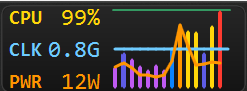

# ShowCPU

A small Windows taskbar widget that shows CPU usage, clock speed, and package power for the last 15 seconds.

It sits on the primary taskbar, next to the notification area, and keeps a tray icon while it runs.



## Features

- **CPU** is the current processor busy percent, shown as a whole number.
- **CLK** is the current clock in GHz. The label turns red when the clock is at or above the processor base frequency.
- **PWR** is CPU package power in watts. It appears when Windows exposes an energy meter, which is typical on Windows 11.
- The graph holds 15 one-second samples. **CPU** is a bar that changes color as usage rises, from violet at the low end to red near 100%. **Clock** is a line, blue under the base frequency and red at or above it. The top of that line is the highest GHz seen so far. **Power** is an orange line whose top is the highest watts seen so far. Both peaks are remembered across launches.
- Drag the widget along the taskbar to move it. The position is saved and restored, including after a display scale or taskbar size change.
- The widget follows the primary taskbar on the bottom, top, left, or right. It hides while the taskbar is hidden and shows again when the taskbar comes back.
- The tray tooltip shows the live readings. Left-click opens **About**. Right-click offers **About**, **Quit**, and **Quit Forever**.
- Running the app registers it to start with Windows for the current user. **Quit** leaves that in place. **Quit Forever** turns start-with-Windows off and exits.
- Only one instance runs. A second launch exits immediately.
- While CPU stays above 95%, a line is appended to `ShowCPU-*.log` in **Downloads**, listing the busiest processes and the clock. Logging waits about 10 seconds between lines, and a new file starts when the current one would pass 10 MB.

## Requirements

- Windows 10 or later
- [.NET 10 SDK](https://dotnet.microsoft.com/download/dotnet/10.0)

## Build

From the repository root:

```bat
dotnet restore
dotnet build -c Release
```

The output is under `bin\Release\net10.0-windows\`.

## Run

```bat
dotnet run -c Release
```

Or start the built app:

```bat
bin\Release\net10.0-windows\ShowCPU.exe
```

Use the tray icon for **About**, **Quit**, and **Quit Forever**. Drag the widget along the taskbar to move it.
